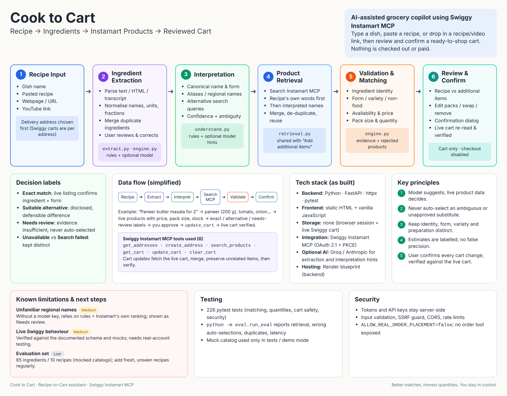

# Cook to Cart

Turn a dish name, a pasted recipe, a recipe page URL or a YouTube link into a **Swiggy Instamart cart** you review and confirm yourself.

- **Cart only.** Nothing is checked out or paid. Order placement is disabled (`ALLOW_REAL_ORDER_PLACEMENT=false`, no order tool is exposed).
- **Live products.** In live mode every product, price, pack size and stock status comes from the official Swiggy Instamart MCP. The mock catalog is used only in `INSTAMART_MODE=local` (demos, tests, screenshots).
- **You stay in control.** A product is only auto-selected when its live listing confirms the ingredient. Everything else is shown as *Needs review* and added only after you approve it.

## Architecture overview



Source of the diagram: `docs/architecture.png` (stack shown is the stack as built: FastAPI backend, static HTML + vanilla JS frontend, no database).

## How it works

1. **Recipe** — choose a delivery address, then enter a dish, recipe, URL or video link. Review and correct the extracted ingredients, servings, budget and pantry.
2. **Products** — each ingredient gets the best live match, alternatives, pack counts and honest quantity/leftover estimates. **+ Add additional items** searches Instamart for anything else (milk, eggs, snacks…).
3. **Review** — recipe items and additional items are listed separately. **Add to Instamart Cart** opens a confirmation dialog; nothing changes until you press **Confirm cart update**. The live cart is then re-read and verified before success is shown.

Match labels: **Exact match**, **Acceptable/Suitable alternative**, **Needs review**, **Unavailable** (and *Search failed*, which is different from unavailable).

## Project layout

```
backend/            FastAPI app (Python 3.11+)
  main.py           API routes, cart operations (idempotent, verified, one mutation at a time)
  engine.py         parsing, quantities, product validation, ranking, coverage
  understand.py     Stage A: ingredient interpretation (rules + optional model hints)
  retrieval.py      Stage B: live product search shared by recipe matching and manual search
  swiggy.py         Swiggy Instamart MCP client (OAuth 2.1 + PKCE)
  instamart.py      local mock catalog (demo/tests only)
  extract.py, llm.py, visual.py, intent.py   recipe extraction (text, URL, YouTube)
  eval/             evaluation harness on mocked, live-shaped catalogs
  tests/            pytest suite
frontend/           static HTML + vanilla JS (index.html, app.js, config.js)
docs/               architecture diagram
render.yaml         Render deployment blueprint (backend)
```

## Run locally

Requirements: Python 3.11+, any static file server.

```powershell
# Backend (PowerShell)
cd backend
python -m venv .venv ; .\.venv\Scripts\Activate.ps1
pip install -r requirements.txt
$env:INSTAMART_MODE="local"          # mock catalog; use "swiggy" for live Instamart
uvicorn main:app --port 8000

# Frontend (second terminal)
cd frontend
python -m http.server 3000
```

Open <http://localhost:3000>. `frontend/config.js` sets `window.API_BASE` (default `http://localhost:8000`).
After replacing `index.html`/`app.js`, hard-refresh with **Ctrl+F5**.

macOS/Linux: `export INSTAMART_MODE=local` instead of `$env:...`.

## Live Swiggy Instamart mode

```powershell
$env:INSTAMART_MODE="swiggy"
uvicorn main:app --port 8000
```

Click **Connect Swiggy account** in the app and complete Swiggy's login. Then pick a delivery address (Swiggy carts are **per address**: the Swiggy app must show the same address to see the cart).
MCP tools used: `get_addresses`, `create_address` (confirmed by you), `search_products`, `get_cart`, `update_cart` (full replacement, so the app always fetches the live cart, merges, preserves unrelated items and verifies afterwards), `clear_cart` (separate confirmation).

## Configuration (environment variables)

| Variable | Default | Purpose |
|---|---|---|
| `INSTAMART_MODE` | `swiggy` | `swiggy` = live MCP, `local` = mock catalog |
| `ALLOWED_ORIGINS` | `http://localhost:3000` | CORS origins (comma-separated) |
| `FRONTEND_URL` | `http://localhost:3000` | Where the login callback returns |
| `SWIGGY_REDIRECT_URI` | `http://localhost:8000/api/swiggy/callback` | OAuth redirect |
| `SWIGGY_MCP_URL`, `SWIGGY_BASE`, `SWIGGY_CLIENT_ID` | — / `https://mcp.swiggy.com` / — | Swiggy MCP endpoint and client |
| `GROQ_API_KEY` or `ANTHROPIC_API_KEY` | unset | Optional model: recipe extraction from videos, ingredient interpretation hints. Without a key the app falls back to rules + live validation |
| `LLM_MODEL`, `LLM_DAILY_LIMIT`, `LLM_MAX_CHARS` | — / 100 / 20000 | Model choice and spend caps |
| `RATE_LIMIT_PER_MIN` | 60 | Per-client API rate limit |
| `ALLOW_REAL_ORDER_PLACEMENT` | `false` | Keep `false`; order placement is not implemented |
| `VISUAL_*` | see `visual.py` | Limits for video frame analysis |

Secrets stay on the server; the browser never sees tokens or API keys.

## Tests and evaluation

```powershell
cd backend
python -m pytest -q                  # full suite (226 tests at last run)
python -m eval.run_eval              # matching/quantity evaluation on mocked catalogs
```

The evaluation reports interpretation accuracy, product retrieval, wrong auto-selections, forbidden-product labelling, unavailable handling, pack coverage, duplicate cart lines, search failures and latency. See `backend/eval/README.md` for caveats. Mocked products are never shown to users in live mode.

There is no frontend build step; check JavaScript syntax with `node --check frontend/app.js`.

## How matching works

1. **Understand** the ingredient: normalise text, quantities and units; detect form (fresh, powder, paste, whole…); optionally ask a model for regional names and search queries (hints only, with confidence).
2. **Retrieve** live products: the recipe's own words first, then the interpreted meaning; results merged and de-duplicated; identical queries reuse results.
3. **Validate** every product: right ingredient and form, not confectionery/non-food, not a processed or combined variant, not a different variety, available, priced. Hinted names count only when the live product itself confirms them.
4. **Rank** by identity, form, availability, pack fit, rating and price.
5. **Decide**: Exact / Suitable alternative / Needs review / Unavailable — each with the evidence and the rejected products.
6. **Quantities**: leftovers are computed in the product's own unit; conversions that use a density or piece weight are labelled *estimated* and rounded; if no reliable conversion exists the app says so and assumes one pack.

## Deployment (Render)

`render.yaml` deploys the backend (default `INSTAMART_MODE=local`; switch to `swiggy` and set the Swiggy variables for live use). Host `frontend/` on any static host and set `window.API_BASE` in `config.js` to the backend URL; add that frontend origin to `ALLOWED_ORIGINS`.

## Known limitations

- Live Swiggy behaviour (cart visibility in the Swiggy app, fee fields in the bill) depends on what the MCP returns and has only been exercised against the documented schema.
- Without a model key, regional names rely on rules plus Instamart's own search ranking; unfamiliar names are offered as *Needs review*, never auto-selected.
- Density and piece-weight conversions are approximations and always shown as estimates.
